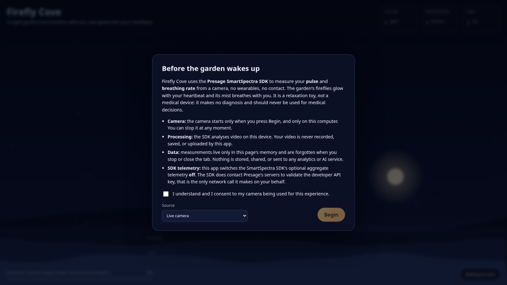
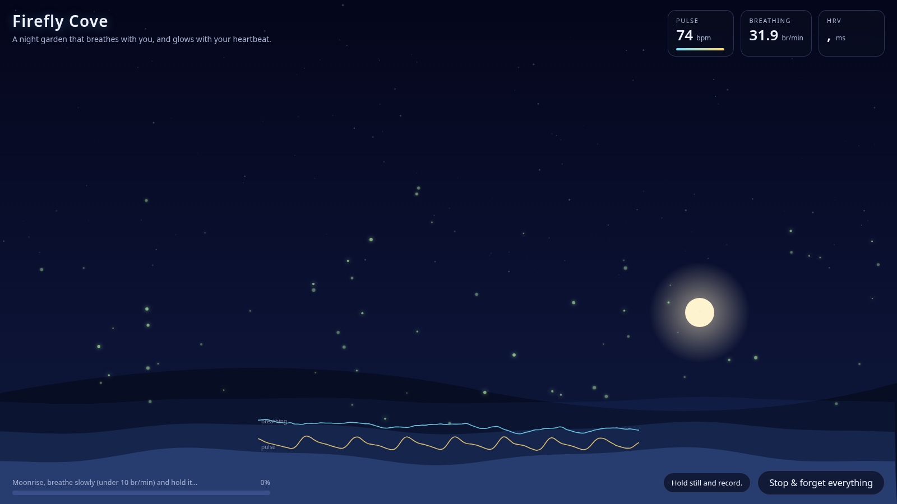

*This is a submission for the [Presage SmartSpectra SDK Challenge](https://dev.to/challenges/presage-2026-11-04)*

## What I Built

**Firefly Cove** is a quiet night garden that is alive with *your* physiology. Sit down in front of your webcam and the cove responds to you in real time:

- The **fireflies glow with your heartbeat**, their brightness follows your live pulse waveform, and every detected heartbeat sends a ripple across the water.
- The **mist breathes with you**, the swell of the fog over the water is driven by your live chest-breathing waveform.
- **Moonrise** is a tiny game played with no controller: breathe slowly (a stable rate under 10 breaths/min) and hold it, and the moon climbs, the stars come out, and the fireflies turn gold.
- A live HUD shows your pulse (bpm), breathing rate (br/min), HRV when the SDK reports it, per-measurement confidence, and a waveform strip plotting the actual breathing and pulse traces, because the signals *are* the experience, they should be visible.

It's built for one person, alone, taking a minute to slow down. No accounts, no wearables, nothing to install beyond the project itself.

## Demo



Watch it on YouTube: https://youtu.be/cDciHtuf5eg

## Code

https://github.com/dunoil/firefly-cove

The repository includes full setup instructions (free Presage API key registration, `.env` configuration, camera mode and video-file mode). The whole app is one Node server plus a static page, no build step, no database, no framework.

## How It Responds to Human Signals

Firefly Cove integrates the **SmartSpectra SDK** through the official Node package (`@smartspectra/node-sdk` v3.5.0), running in its headless camera mode inside a small Node server. The server requests the SDK's breathing and cardio metric bundles and decodes every protobuf `Metrics` packet with the SDK's own message classes:

- **Pulse rate** (`cardio.pulseRate`) drives the HUD readout and its confidence bar.
- **Arterial pressure trace** (`cardio.arterialPressureTrace`) is the heartbeat of the scene: it modulates firefly glow continuously, and a mean-crossing detector on the trace fires a water ripple for each beat.
- **Breathing rate** (`breathing.rate`) drives the HUD and the Moonrise rule: stable readings at or under 10 br/min accumulate calm progress; faster breathing lets it ebb away.
- **Chest breathing trace** (`breathing.upperTrace`) swells the mist and water layers through rolling min/max normalization, so the cove literally inhales and exhales with the visitor.
- **HRV** (`cardio.hrv`) is displayed whenever the SDK reports it.
- **Validation status** events are surfaced verbatim as a guidance pill ("no face found", "too dark", …), so the SDK itself teaches the visitor how to be measured.

Decoded metrics are normalized into small JSON events and streamed to the browser over Server-Sent Events; all scene rendering happens locally in a canvas. When no signal is present, the scene idles dimly and the HUD shows dashes, the experience never pretends to have data it doesn't.

The SDK can also measure from a **recorded video file** (`useFile()`), which the project supports as a first-class mode: it makes the experience testable without a camera and gives judges a reproducible way to run it.

## Prize Categories

I'm entering **both** prize categories:

**Most Creative or Delightful Use**, I wanted to see whether vitals could feel like a *place* instead of a dashboard. Firefly Cove turns two physiological waveforms into weather: your pulse becomes light, your breath becomes mist, and calming your own body becomes the only game mechanic. The win state isn't a score, it's a moonrise you caused by actually relaxing.

**Best Thoughtful Real-World Use**, Slow, deliberate breathing is one of the simplest evidence-informed ways to downshift during a stressful workday, but it's hard to stick with when you're just counting in your head. Firefly Cove gives the practice a gentle, visible feedback loop with zero wearables and zero setup. It is designed for exactly the people who would never open a "wellness dashboard": consent-first, nothing stored, nothing shared, and a stop button that forgets everything. It is a relaxation aid only, it makes no diagnosis or treatment claims and is not a medical device.

## Consent and Data Handling

- **Consent before camera.** The camera cannot start until the visitor reads an in-app consent card, covering what is measured, how it is processed, and what is (not) stored, and actively ticks a checkbox. The Begin button is disabled until then. Consent is per-session; stopping returns to the consent card.
- **On-device processing.** The SmartSpectra SDK analyzes video on the visitor's own machine (native inference). This app never records, saves, screenshots, or uploads video or images, covertly or otherwise. Monitoring is impossible without the visitor starting it themselves, in person.
- **Storage: none.** Measurements exist only in the page's memory while a session runs. There is no database, no file logging of vitals, no persistence of any kind. Pressing "Stop & forget everything" destroys the SDK session and clears every displayed value.
- **Sharing: none.** No analytics, no third-party scripts, no social embeds. Decoded metrics travel only from the local server process to the visitor's own browser tab on `127.0.0.1`.
- **SDK telemetry: disabled.** The SmartSpectra SDK offers optional, aggregate, per-session diagnostic telemetry (session shape and performance counts only, per Presage's documentation it never includes frames or measured values). Firefly Cove opts out anyway: `enableTelemetry: false` is set in code, so the SDK starts no telemetry session. The only network communication the SDK performs is its own API-key authentication and metrics authorization with Presage's servers, which the SDK requires to operate.
- **Optional AI services: none.** The SDK's optional LLM Insights feature is never invoked; no vitals or derived data are sent to any AI service.
- **Retention & deletion.** With no storage, retention is zero by construction and deletion is immediate on stop, tab close, or server shutdown.
- **Wellness, not medicine.** SmartSpectra metrics are for general wellness and informational purposes only and are not FDA-cleared for diagnosis or treatment; Firefly Cove presents them accordingly and makes no medical claims.

## Agent Session

<!-- OPTIONAL (encouraged): upload the agent session transcript at
     https://dev.to/agent_sessions/new, click "Make Public", and embed it
     here. Check the transcript for keys/sensitive data first. -->
